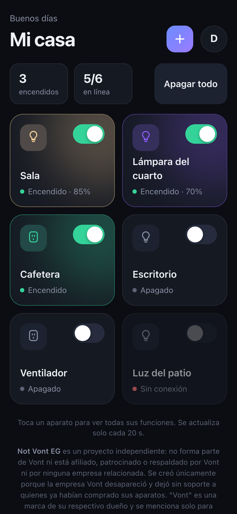
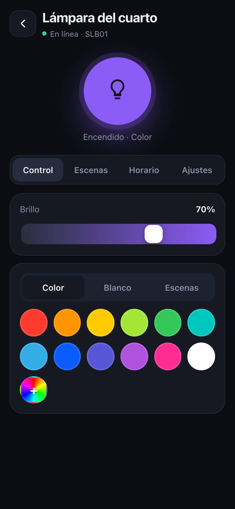
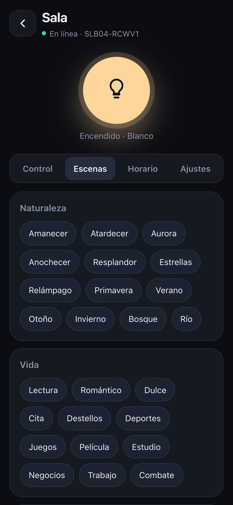
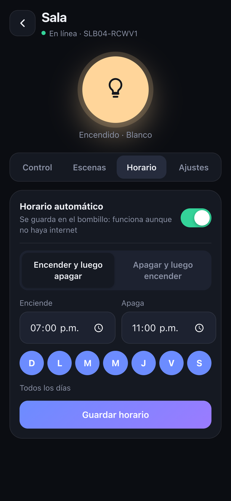
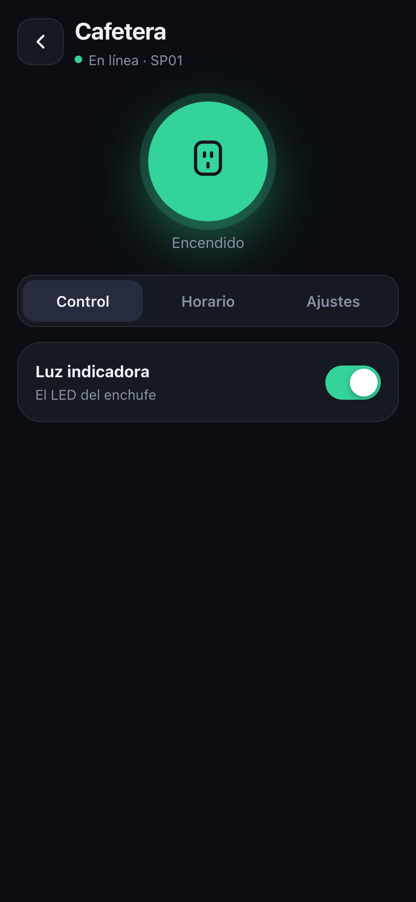
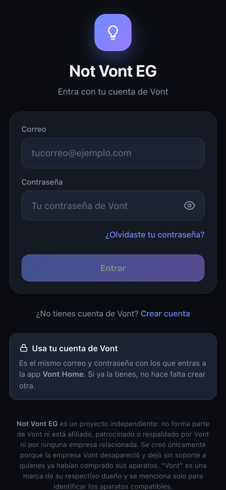

# Not Vont EG

App web abierta para controlar **bombillos y enchufes inteligentes Vont**, que se quedaron
sin app oficial. Prende y apaga, cambia brillo y colores, usa escenas, programa horarios,
agrega aparatos por Bluetooth, les cambia el Wi-Fi y los conecta a Alexa.

> **Proyecto independiente.** No está afiliado, patrocinado ni respaldado por Vont ni por
> ninguna empresa relacionada. "Vont" es una marca de su respectivo dueño y se menciona solo
> para indicar con qué aparatos es compatible. Úsalo con tus propios aparatos y bajo tu
> responsabilidad.

## Capturas

  
  
  

  
  
  

## Qué hay aquí

| Carpeta | Qué es |
|---|---|
| [`app/`](app/) | La app: API en **ASP.NET Core (.NET 10) + SQL Server** y web en **Angular 19** (PWA instalable). Ver [`app/README.md`](app/README.md). |
| [`app/esp32/`](app/esp32/) | Firmware MicroPython para una **placa ESP32** que hace de puente Bluetooth: abanico con receptor ZhiMei y tiras LED ELK-BLEDOM, también desde Alexa. |
| [`alexa/`](alexa/) | Skill de **Alexa Smart Home** en una sola Lambda de Python sin dependencias, más una librería y un CLI de pruebas. |
| [`alexa/PROTOCOL.md`](alexa/PROTOCOL.md) | Cómo habla la app con la nube (login, aparatos, control por MQTT). |
| [`alexa/FEATURES.md`](alexa/FEATURES.md) | Funciones de los aparatos: horarios, escenas, cuenta regresiva, etc. |
| [`alexa/BLE_PAIRING.md`](alexa/BLE_PAIRING.md) | Emparejamiento por Bluetooth (Web Bluetooth). |

## Cómo funciona

Los aparatos Vont siguen conectados a la nube de su fabricante (Topband), que sigue en
línea. La app inicia sesión con **tu propia cuenta Vont** y usa esa nube igual que la app
oficial: cada usuario solo ve y controla sus aparatos. No hay cifrado roto ni servidores
de terceros de por medio.

- **Control:** login REST + MQTT sobre TLS.
- **Agregar aparatos:** por Web Bluetooth desde Chrome o Edge en computadora o Android.
  En iPhone no es posible, porque Safari no tiene Web Bluetooth. La contraseña del Wi-Fi
  va directo al aparato y no pasa por ningún servidor.
- **Alexa:** una Lambda que traduce las órdenes de Alexa a la nube.

## Empezar

- App: [`app/README.md`](app/README.md) (desarrollo local, Docker o IIS).
- Alexa: crea una skill *Smart Home* y una Lambda (Python 3.12), pega
  [`alexa/lambda_function.py`](alexa/lambda_function.py) y define `TOPBAND_USER` y `TOPBAND_PASS` (y `NOTVONT_API`, la URL de tu API, para incluir los aparatos de la placa ESP32)
  en sus variables de entorno.

## Licencia

[MIT](LICENSE).
